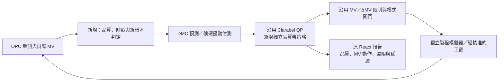

# GuruPrasath（2011）水泥磨 Soft MPC：原始證據審閱

範圍：第 3–7 章及附錄 A，並對照導入前的 repository 控制器與既有驗證結果。此文件保留當時的研究評估快照，不代表後續功能尚未實作。第 1–8 節整理論文，第 9–12 節的「目前」指導入前狀態；後續 Soft-band、資料清洗與 Autoresearch 的現行契約見 [系統設計](../DIGITAL_TWIN_VALIDATION.md)，實驗成效以各次驗收產物為準。

**論文主來源：** M. GuruPrasath, *Robust Model Predictive control of Cement Mill circuits*, PhD thesis, NIT Tiruchirappalli, August 2011，[原始 PDF](https://www2.imm.dtu.dk/~jbjo/PhD_Thesis_2011_GuruPrasath.pdf)。以下「PDF 頁」含封面；本筆記引用的正文頁碼按 PDF 頁 − 17 換算。文字與公式據 PDF 抽取；上下標、矩陣及斷行有 OCR／排版歧義，特別是式 (7.1)，不應直接照抽取文字實作。補充理論來源見第 12 節。

## 1. 最重要的判斷

- **值得驗證的核心是「目標附近低敏感度、帶外高懲罰」的目標函數形狀**，不是看到 slack 或論文標題有 robust 就已得到該方法。這仍是帶硬 MV／ΔMV 限制的線性 FIR、凸 QP、receding-horizon 控制；並未把模型不確定集合放進 min–max／tube 最佳化。見 §3.7，式 (3.22)，印 73–77／[PDF 90–94](https://www2.imm.dtu.dk/~jbjo/PhD_Thesis_2011_GuruPrasath.pdf#page=90)。
- **MHE 是被研究過但未選入後續 Soft MPC 的分支**：噪聲追逐、平滑與擾動拒斥的折衷，以及每次需解估測和控制兩個問題的計算複雜度。不是「MHE + Soft MPC」整套已在工廠證明。見 §3.6–3.7，印 70–74／[PDF 87–91](https://www2.imm.dtu.dk/~jbjo/PhD_Thesis_2011_GuruPrasath.pdf#page=87)。
- **50% 與 23% 是不同情境、不同基準、不同指標**；都不是通用改善保證。名目模型下 conventional MPC 還可能較好。見 §4.7、§6.4，印 92、118／[PDF 109](https://www2.imm.dtu.dk/~jbjo/PhD_Thesis_2011_GuruPrasath.pdf#page=109)、[135](https://www2.imm.dtu.dk/~jbjo/PhD_Thesis_2011_GuruPrasath.pdf#page=135)。

## 2. 精確的 Soft MPC 目標：不是單純放寬安全上／下限

為消除原文重複使用 `S` 的歧義，以下將 MV 移動懲罰寫成 \(S_u\)，slack 二次懲罰寫成 \(S_\eta\)，線性懲罰寫成 \(s_\eta\)。\(\|v\|_Q^2=v^TQv\)。這是式 (3.22) 與附錄 (A.32–A.35) 的一致重寫：

\[
\min_{U,Z,\eta}\ J=
\frac12\sum_{k=0}^{N-1}\left[
\|z_{k+1}-r_{k+1}\|_{Q_z}^2+\|\Delta u_k\|_{S_u}^2\right]
+\sum_{k=1}^{N}\left[\frac12\|\eta_k\|_{S_\eta}^2+s_\eta^T\eta_k\right].
\]

約束為

\[
z_k=b_k+\sum_{i=1}^{n}H_i u_{k-i},\qquad
u_{\min}\le u_k\le u_{\max},\qquad
\Delta u_{\min}\le\Delta u_k\le\Delta u_{\max},
\]
\[
z_{\min,k}-\eta_k\le z_k\le z_{\max,k}+\eta_k,\qquad\eta_k\ge0.
\]

同一 CV／預測步的非負 slack 放寬上下兩側；不是全 horizon 共用一個 scalar。輸出帶可違反而受罰；MV 與 ΔMV 仍是硬約束。附錄以 \(Z=c+\Gamma U\)、\(\Delta U=\Lambda U-I_0u_{-1}\) 消去輸出，決策變數 \(x=[U;\eta]\)，得到

\[
\bar H=\operatorname{diag}(\Gamma^TQ_z\Gamma+\Lambda^TS_u\Lambda,S_\eta),\qquad
\bar g=[\Gamma^TQ_z(c-R)-\Lambda^TS_uI_0u_{-1};s_\eta].
\]

其中權重為 horizon 堆疊矩陣；\(R\) 此處是堆疊目標，不是某些章節文字稱的 regularization weight。約束矩陣的 block rows 是 \([\Lambda,0]\)、\([\Gamma,-I]\)、\([\Gamma,I]\)。式 (A.37) 的 ΔU 界限需與 (A.11) 的第一步已知 \(u_{-1}\) 位移一致理解，不能只抄符號而漏掉當前 MV。來源：§3.7，印 74／[PDF 91](https://www2.imm.dtu.dk/~jbjo/PhD_Thesis_2011_GuruPrasath.pdf#page=91)；附錄 A.1，印 132–134／[PDF 149–151](https://www2.imm.dtu.dk/~jbjo/PhD_Thesis_2011_GuruPrasath.pdf#page=149)；A.3，印 138–142／[PDF 155–159](https://www2.imm.dtu.dk/~jbjo/PhD_Thesis_2011_GuruPrasath.pdf#page=155)。

**[INFERENCE：由上述標量／對角權重目標直接消去 slack]** 對稱目標帶 \([r-\delta,r+\delta]\)，正向 slack 懲罰下，\(\eta^*(e)=\max(|e|-\delta,0)\)，其中 \(e=z-r\)。輸出 stage cost 為

\[
\rho(e)=\tfrac12 q e^2+\tfrac12 w\,[\max(|e|-\delta,0)]^2+
\ell\max(|e|-\delta,0).
\]

| 機制 | 帶內 | 帶外 | 不可混淆之處 |
|---|---|---|---|
| 普通追蹤 + 可放寬 CV 限制 | 原追蹤權重照樣作用 | 追蹤 + 違限成本 | 若限制只是遠方安全界線、追蹤權重仍高，不會自動得到本文近目標降敏感度 |
| 論文 Soft MPC | **很小但非零的** \(q e^2/2\) | 另加 slack 的二次／可選線性成本 | 是近似 dead zone；利用「目標帶 + 小追蹤權重」配置既有 slack 結構 |
| 純 deadzone／純 zone control | 追蹤成本恰為零 | 帶外才罰 | 帶內任一位置可能等價；不等於本文保留小追蹤成本的設計 |

原文以小二次項追求零穩態偏差，但不是任何擾動／模型失配下的無條件保證；simple estimator 仍以當前 bias 延伸整個未來 horizon。SISO 範例 conventional \(Q_z=1\)，soft \(Q_z=0.001\)，所以效果不能全歸因於「多了一個 slack」；工廠實例更令 slack 線性權重為 **0**，不是必須含非零 L1 項。見 §3.3.3、§3.7.1、§4.3.1、§6.3，印 53–54、75–76、82、116／[PDF 70](https://www2.imm.dtu.dk/~jbjo/PhD_Thesis_2011_GuruPrasath.pdf#page=70)、[92](https://www2.imm.dtu.dk/~jbjo/PhD_Thesis_2011_GuruPrasath.pdf#page=92)、[99](https://www2.imm.dtu.dk/~jbjo/PhD_Thesis_2011_GuruPrasath.pdf#page=99)、[133](https://www2.imm.dtu.dk/~jbjo/PhD_Thesis_2011_GuruPrasath.pdf#page=133)。

**落地條件：** 要有可接受的品質帶、CV 單位／正規化、噪聲統計及可接受的 MV 動作成本；一起選擇 \(\delta,Q_z,S_u,S_\eta,s_\eta\)，而非只調 band。§3.7.2 提醒 band 太寬會遲鈍／偏差、太窄退回 conventional 行為；但所給「band 約為 variance 的 0.8–0.9 倍」有量綱問題（variance 是 CV 單位平方），只能當原文經驗敘述，不能當普適調參公式。見印 76–77／[PDF 93–94](https://www2.imm.dtu.dk/~jbjo/PhD_Thesis_2011_GuruPrasath.pdf#page=93)。

## 3. MHE：做了什麼，為何沒有沿用

- FIR 中另加未知擾動通道 \(H_{d,i}\)，從歷史量測反推擾動序列；目標為 \(\frac12\sum(\|z-y\|_{Q_z}^2+\|\Delta d\|_S^2+\|d\|_R^2)\)，加上 \(d\) 與 \(\Delta d\) 的硬界限。擾動拆為慢變 level \(\bar d\) 與快速過程噪聲 \(w\)，典型 \(S=\mathrm{diag}(S_d,0)\)、\(R=\mathrm{diag}(0,R_w)\)。不是僅把 residual 再平均一次。來源：§3.5，式 (3.13–3.17)，印 64–66／[PDF 81–83](https://www2.imm.dtu.dk/~jbjo/PhD_Thesis_2011_GuruPrasath.pdf#page=81)；附錄 A.2，(A.13–A.23)，印 135–138／[PDF 152–155](https://www2.imm.dtu.dk/~jbjo/PhD_Thesis_2011_GuruPrasath.pdf#page=152)。
- 範例有 FIR 長度 50、估測窗 200、控制 horizon 200；measurement noise 標準差 0.2，低 regularization 時估測擾動標準差約 0.18，幾乎追逐量測噪聲。提高權重能平滑估測，卻延遲真擾動辨識／拒斥；延遲模型亦讓估測落後。閉迴路 regulator 對不平滑估測動作，製造真實製程變動。見 §3.6，印 67、70–73／[PDF 84](https://www2.imm.dtu.dk/~jbjo/PhD_Thesis_2011_GuruPrasath.pdf#page=84)、[87–90](https://www2.imm.dtu.dk/~jbjo/PhD_Thesis_2011_GuruPrasath.pdf#page=87)。
- 作者結語是 **“MHE is no panacea to MPC”**；§3.7 明確因計算複雜、需解 estimation 與 regulation，選 simple estimator。不是證明所有 MHE 都較差，也未證明其工廠硬體必然超時。
- 若要獨立評估 MHE，必須先定義擾動通道、噪聲模型、level／noise 權重與界限、估測窗、歷史初始化及未來擾動延伸；另比較估測延遲、噪聲導致的 MV 動作及每掃描計算成本。這是方法需求，不是本 repo 已實現／已驗證的主張。

## 4. 模型辨識：SOPDT-with-zero 不是水泥磨通用模型

SISO 教學／失配實驗使用

\[
G(s)=\frac{K(\beta s+1)}{(\tau_1s+1)(\tau_2s+1)}e^{-\theta s},
\]

名目 \(K=1,\tau_1=\tau_2=5,\beta=2,\theta=5,T_s=1\)，ZOH 離散化後形成 FIR。實驗另有擾動通道，名目採相同參數；這不是水泥磨實測後所有通道都必須遵循的形式。見 §3.4、§3.6、§4.2，印 54–55、67、80／[PDF 71–72](https://www2.imm.dtu.dk/~jbjo/PhD_Thesis_2011_GuruPrasath.pdf#page=71)、[84](https://www2.imm.dtu.dk/~jbjo/PhD_Thesis_2011_GuruPrasath.pdf#page=84)、[97](https://www2.imm.dtu.dk/~jbjo/PhD_Thesis_2011_GuruPrasath.pdf#page=97)。

水泥磨則各操作點分別穩定、逐一對 feed／separator 施加 step，記錄所有 outputs，再以 transfer-function step response 近似擬合；模擬器含不同幅度／方向及 grindability 28／36，實廠多次 step 且辨識期間將實驗室細度取樣加快至每 15 分鐘。模擬模型式 (5.1) 的四通道混合二階、二階含零點與一階，並有不同增益正負與 dead time；實廠式 (6.2) 又是另一組模型。不能把章 3 的單一 SOPDT 參數當成工廠模型，也不能把 CEMulator 辨識等同實廠驗證。見 §5.4–5.5，印 100–105／[PDF 117–122](https://www2.imm.dtu.dk/~jbjo/PhD_Thesis_2011_GuruPrasath.pdf#page=117)；§6.3，印 113–115／[PDF 130–132](https://www2.imm.dtu.dk/~jbjo/PhD_Thesis_2011_GuruPrasath.pdf#page=130)。

方法需求：涵蓋完整 MIMO 交互影響、保留 dead time／零點／高階動態、註明操作點和 recipe、讓辨識採樣與實際量測鏈一致；FIR 截斷需覆蓋足夠長的衰減尾端。作者 §3.3 限定 stable process；不能未經處理便外推到 integrating／unstable plant，見印 50–52／[PDF 67–69](https://www2.imm.dtu.dk/~jbjo/PhD_Thesis_2011_GuruPrasath.pdf#page=67)。

## 5. 變數與細度定義：摘要把 input／output 顛倒

正確製程方向為 **MV \(u=[\text{Fresh feed rate};\text{Separator speed}]\) → CV \(y=[\text{Elevator load/power};\text{Fineness}]\)**。Elevator power 是磨機裝載／循環料量的代理量；clinker grindability 在模擬中作擾動。摘要印 iv／PDF 6 把 process input／output 寫反；應以正文式 (4.4)、(5.1)、(6.2)、表 5.1 為準。見 §4.6、§5.3、§6.3／[PDF 106](https://www2.imm.dtu.dk/~jbjo/PhD_Thesis_2011_GuruPrasath.pdf#page=106)、[117](https://www2.imm.dtu.dk/~jbjo/PhD_Thesis_2011_GuruPrasath.pdf#page=117)、[122](https://www2.imm.dtu.dk/~jbjo/PhD_Thesis_2011_GuruPrasath.pdf#page=122)、[131](https://www2.imm.dtu.dk/~jbjo/PhD_Thesis_2011_GuruPrasath.pdf#page=131)。

Fineness 在主要控制實例指 **Blaine 比表面積**，不是直接顆粒直徑，也不是單一篩餘百分比。論文亦討論 final-product residue（22 μm sieve），但這是相關而不同的品質指標。圖 6.6 用 m²/kg、圖 7.2 用 cm²/g；量級約 300 與 3000 不可直接混用（1 m²/kg = 10 cm²/g）。量測可能是 online analyzer／soft sensor，也可能每小時採樣、分析後人工登錄的 lab 值；不能都當每分鐘新量測。見 §6.2–6.3、§7.1–7.2，印 112–114、117、120–123／[PDF 129–131](https://www2.imm.dtu.dk/~jbjo/PhD_Thesis_2011_GuruPrasath.pdf#page=129)、[134](https://www2.imm.dtu.dk/~jbjo/PhD_Thesis_2011_GuruPrasath.pdf#page=134)、[137–140](https://www2.imm.dtu.dk/~jbjo/PhD_Thesis_2011_GuruPrasath.pdf#page=137)。

## 6. 大取樣延遲：經驗近似，不是完整 multirate estimator

第 7 章明言問題可以當 multi-rate control 處理，但該章**選擇當 sample-measurement-delay 問題**：原本快速資料建模，部署時 fineness 每小時更新；提議在相關 controller model 原有 delay 上加約半個量測取樣週期，例：60 分鐘 → 額外 30 分鐘。重新得到 FIR 係數／預測矩陣／bias 與 QP Hessian，不是把 MPC 執行週期改成 30 或 60 分鐘。見 §7.1–7.3、表 7.1，印 120–125／[PDF 137–142](https://www2.imm.dtu.dk/~jbjo/PhD_Thesis_2011_GuruPrasath.pdf#page=137)。

- 證據是 **CEMulator** 比較：未加 delay 的控制器需 3–4 次重調，提升機負載 settling 約 3.5 h、細度仍有 offset；加 delay 方案報告約 1 h、細度標準差接近零，使用一次調整。不是全體工廠、任意非同步／分析延遲下都可免調參的定理。
- **原文／OCR 歧義：** PDF 141／印 124 正文說在「Fineness versus Feed and separator speed」加 30 min；抽取式 (7.1) 卻看似把 \(e^{-31.5s}\) 放在第一列第二欄、\(e^{-35s}\) 放第二列第一欄，而第二列第二欄仍 \(e^{-0.1s}\)。在宣稱 exact matrix reproduction 前，必須直接核對原 PDF 圖面並釐清與變數排序的矛盾；此筆記不將該矩陣當已確認可用係數。
- **[INFERENCE：部署需求]** 半週期只是一種近似。需分開記錄 sample collection time、lab analysis／arrival time、樣本涵蓋區間及下一次更新時間；辨識 sample-and-hold、固定分析延遲與變動／缺測，避免反覆把舊 lab 值當獨立新資料。第 7 章未提供完整 timestamp-aware、out-of-sequence 或 missing-data estimator 的實作規格。不能僅因有 hourly sample 就不加辨別地套 30 min。

## 7. 百分比與比較邊界

| 說法 | 原始對照與指標 | 能說／不能說 |
|---|---|---|
| 「失配超過 50%」 | 摘要、章 3/4 的特定 SISO／MIMO 模擬；各別改 gain、delay、zero、time constant | 是指定模型／權重下振盪的觀察；不是所有參數聯合 ±50% 的 robustness envelope，更不是穩定邊界證明 |
| 「MV variations 降低 50%」 | 摘要印 iv／PDF 6：rigorous cement simulator，soft 對 conventional MPC | 摘要未給統一 variation 定義；不可改寫成 CV 品質、能耗或所有 MV 標準差都減半 |
| 模擬器更具體數值 | §6.2 圖 6.3、§6.4：feed range 約 110–140 → 125–138 t/h；feed SD 4.4258 → 3.269；separator SD 2.4149 → 0.0878 | SD 算術降幅分別約 **26.1%** 與 **96.4%**，不是一致 50%。feed range 約減 56.7%，也不可假定就是摘要 50% 的正式定義 |
| 「品質 SD 降低約 23%」 | §6.4：**實廠 Soft MPC 對現有 Fuzzy Logic Controller**，相似工況、相同 recipe，指 fineness SD | 不是對 conventional MPC，更不是本 repo 結果；章 6 結論未列出可重算這 23% 的兩個品質 SD 原始數值 |

來源：摘要／[PDF 6](https://www2.imm.dtu.dk/~jbjo/PhD_Thesis_2011_GuruPrasath.pdf#page=6)；§3.8，印 77–78／[PDF 94–95](https://www2.imm.dtu.dk/~jbjo/PhD_Thesis_2011_GuruPrasath.pdf#page=94)；§6.2–6.4，印 110–118／[PDF 127–135](https://www2.imm.dtu.dk/~jbjo/PhD_Thesis_2011_GuruPrasath.pdf#page=127)。

實廠比較還有重要條件：兩者共用 elevator-load target adaptation；PLC 資料記錄 10 s、expert tool 更新 30 s、MPC 執行 1 min、FLC 計算 30 s、品質 lab 每小時一次。圖 6.5 時 actuator 在上限附近，部分平滑來自可動範圍受限；作者明示這個限制，另用圖 6.6 展示較有餘裕情況。不是控制變因完全相同的 randomized experiment，也沒有在此提供 raw data、重複試驗或統計信賴區間。見 §6.3，印 113–117／[PDF 130–134](https://www2.imm.dtu.dk/~jbjo/PhD_Thesis_2011_GuruPrasath.pdf#page=130)。

## 8. 能採用的需求，與不能宣稱的保證

1. **先辨識行為再選模型形式：** full MIMO、操作點／recipe、單位／增益方向、延遲、取樣鏈與噪聲；不要從論文四個 transfer functions 直接推廣所有水泥磨。
2. **分開三個候選變更：** 近目標低權重 soft band、MHE、稀疏品質量測處理不是同一必要套裝；每個要有獨立對照，避免無法歸因。
3. **同時衡量取捨：** MV total variation／ΔMV、CV 誤差與帶外時間、最大違限、擾動 settling、飽和時間及求解成本。僅減少 MV 動作可能只是變鈍；作者名目模型對照也承認 conventional MPC 稍佳（§4.6–4.7，印 91–92／[PDF 108–109](https://www2.imm.dtu.dk/~jbjo/PhD_Thesis_2011_GuruPrasath.pdf#page=108)）。
4. **穩定性邊界：** 已閱讀的方法及附錄呈現有限模擬／工廠觀察與凸 QP 推導；不是對界定不確定集合的 robust-stability、recursive-feasibility 或 constraint-satisfaction 證明。輸出 slack 不能修復互相矛盾的 MV／ΔMV 硬限制。要宣稱此類保證，必須另給假設、集合與證明；不能以圖上振盪消失替代。

作者自己在 Future Scope 提出未來用 SOCP **inherently handle uncertainties**，並建議讓比較控制器在相同 settling-time 等條件下最佳調參後再比。這支持把現有貢獻定位為有實證潛力的低敏感度設計，而不是已完成普遍 robust optimal control。見印 131／[PDF 148](https://www2.imm.dtu.dk/~jbjo/PhD_Thesis_2011_GuruPrasath.pdf#page=148)。

## 9. 與目前實作的對照

| 面向 | 目前程式證據 | 論文差異與導入判斷 |
|---|---|---|
| 控制核心 | `apc_engine/src/dmc.rs`：step-response DMC、Clarabel 凸 QP；硬 MV／ΔMV 限制、每 CV／預測步非負 slack | 同一方法家族，無須更換 solver 或整個服務架構 |
| 品質成本 | `dmc.rs:146–176`：追蹤、MV 移動、二次 slack；沒有線性 slack 項 | 目前已接近論文線性 slack 權重為零的形式；關鍵是低追蹤權重與目標附近品質帶，不是「第一次加入軟限制」。論文實廠也用零線性 slack |
| Zone 模式 | `dmc.rs:149` 將當前 PV clamp 至上下限作為 target，仍有追蹤成本 | 不是真正帶內零成本，也不能只選 Zone 就宣稱完成論文方法 |
| 品質帶與操作界線 | `config.rs` 有 limits、weight、alpha、slack_weight，沒有獨立品質帶 | 可先以既有二次 slack 做對照；正式功能應分開目標品質帶、操作違限判定及獨立安全保護，避免靠放寬限制取得好分數 |
| 估測 | `dmc.rs:113–143` 每掃描由目前 PV 重建預測基準；`cv_bias` 是診斷，沒有獨立濾波擾動狀態／MHE | 保留 DMC 偏差修正基線；若噪聲或慢漂移明顯，再評估簡單 disturbance observer。MHE 是後續候選，不是必需品 |
| OPC 量測 | `opc_interface.rs:22–46` 請求兩種 timestamps、檢查 Bad status，但最後僅回傳 `Vec<f64>` | source timestamp／到達時間／freshness 沒有進入控制介面；化驗資料需避免把舊結果每分鐘當成新量測 |
| 模型 | `modelloader.rs` 原生 parametric 為 FOPDT；step-response 可載入一般曲線 | SOPDT／含零點模型可先轉成正確取樣的階躍係數；原生辨識／參數 schema 需另擴充，不必因此更換控制核心 |
| 驗證製程 | `campaign_plant.rs` 為獨立二階串接、延遲、致動器、非線性及噪聲；所有 CV 每掃描有新量測 | 尚不涵蓋含零點動態、每小時化驗／到達延遲、較大模型失配。不能把現有通過結果當作論文方法的驗證 |

另有兩個上線前的既有介面差異，不能用新演算法掩蓋：

- `apc_engine/src/main.rs:694–730,1027–1085` 讀取 MV `op` 作為當前輸入，卻寫入 `sp`。PID OP 可能是閥位 %，SP 可能是流量 t/h；必須以實際 ABB tag 的物理量、單位及模型輸入定義核對，不能默認可相加。這是待核實的映射風險，不是已知現場接錯。
- production parametric 分支 `main.rs:302–319` 的 DV coefficients 為空；production step-response loader 要求曲線長度等於 prediction horizon。若延伸 DV 建模或長記憶模型，必須同步處理 production 與 campaign 的契約差異。論文方法本身不會解決這些介面問題。

目前 production engine 使用 OPC UA；既有 campaign 的 COM DA adapter 是另一條驗證路徑。控制成本可共用，但 campaign 通過不代表已完成 ABB 現場連接驗證。

## 10. 既有數據顯示的改善空間，不是新方法成效

來源：[`verified-runs/synthetic-cement-2026-q1/report.json`](verified-runs/synthetic-cement-2026-q1/report.json)，March holdout，44,640 個一分鐘掃描。January 辨識、February 選參、March 評估；下表取既有 baseline／optimized，而非本次新增實驗。

| 指標 | Baseline | Optimized | 相對變化 |
|---|---:|---:|---:|
| 細度 RMSE，m²/kg | 0.8077 | 0.4950 | −38.71% |
| 磨差壓 RMSE，mbar | 0.5050 | 0.1955 | −61.28% |
| Fresh Feed 累積 MV total variation，t/h | 1785.61 | 2490.89 | +39.50% |
| Separator 累積 MV total variation，rpm | 2277.02 | 7456.05 | +227.45% |

TV 為整段時間的 `Σ|Δu|`，不是平均速度或能耗；RMSE 不是論文報告的標準差。這表示現有最佳化以較多 MV 動作換到較低追蹤誤差，不表示既有最佳化錯誤；是否值得取決於品質容許帶、致動器及生產成本。

`examples/cement_campaign.json` 的 truth 時間常數約 60–240 秒、延遲 60–120 秒，gain variation 0.035；論文水泥磨有數十分鐘時間常數及小時級化驗間隔。既有模型記憶 32 分鐘、預測 48 分鐘，不能不重估就搬到該慢速製程。現有 CV「磨差壓」也不等於論文「提升機負載」；separator rpm／% 與 Blaine m²/kg／cm²/g 必須換算後重新辨識／調參。

**[INFERENCE] 最有價值的候選收益是：在相同品質合格要求下減少不必要的 MV 動作，並改善失配／稀疏量測情境；不是預先承諾 RMSE、能耗或所有指標同時下降。** 沒有功率／產量模型時，不能以 MV TV 下降宣稱 kWh/t 改善。

## 11. 建議的漸進導入與完整驗證

以下是尚未實作、尚未執行的方案，不是已驗證成效。

導入順序：

1. **先統一資料契約。** 核對 MV 是 PID SP、實際流量還是 OP；量測攜帶數值、品質、取樣時間、可用時間及新樣本資訊。沒有新化驗值時依模型傳播；新結果抵達才依其實際取樣時間更新。區間混合樣要有相應量測模型。
2. **先做最接近論文的低複雜度候選。** 保留現有 QP、二次 slack、硬 MV／ΔMV；設定較小追蹤權重及目標附近品質帶。正式 schema 將品質帶與操作上下限分開；線性 slack 可選，但不是重現論文實廠方法的必要條件。記錄有效參數、單位與版本，禁止硬寫論文常數。
3. **模型與估測分開改。** 用相同資料比較 FOPDT、較高階模型及 FIR 預測誤差；確認長記憶／horizon 足夠，再比較簡單濾波擾動估測。只有後者不能滿足需求且 MHE 在 holdout 證明增益，才加入 MHE。
4. **擴充獨立驗證製程，不只回放。** 加入較慢動態、增益／時間常數／dead time 失配、不同操作區間、化驗 sample-and-hold／分析延遲／抖動／缺測／品質異常。論文「半取樣週期附加延遲」只作候選對照，不能取代正確量測時序，也不可重複計入已辨識的延遲。
5. **最後擴充 Autoresearch 的受控搜尋。** 搜尋品質帶、追蹤／MV／slack 權重與估測參數；固定工程安全限制，按品質要求與 MV 動作的 Pareto 取捨選擇，不以單一名目 RMSE 決勝。所有候選使用相同訓練／調參資料與搜尋資源。

### 消融對照

| 組別 | 改變項 | 要回答的問題 |
|---|---|---|
| A | 現有控制器 | 基準 |
| B | 低追蹤權重＋二次 soft quality band | 論文核心是否已足夠改善品質／MV 取捨？ |
| C | B＋量測時序感知及簡單擾動估測；另保留逐項單獨對照 | 收益來自量測處理還是成本函數？ |
| D，可選 | C 的相同模型／資訊，改用 MHE | 多一個最佳化問題是否真的值得？ |
| 延遲專項 | 半取樣週期近似 vs 時戳感知估測 | 固定延遲近似對缺測／抖動是否仍可靠？ |

辨識、選參、最終 holdout 按連續時間及操作工況隔離；不可隨機打散相鄰樣本，不可提前使用尚未出爐的化驗值。使用多個配對亂數種子與未見工況，報告配對差異、不確定區間及最差情境。共同調校固定的一組對照用來隔離機制；等量搜尋資源的另一組用來比較各方案調校後能力。

**通過標準：** 先滿足預先定義的品質／違限、硬 MV／ΔMV、求解成功及掃描 deadline 要求，再比較 MV TV、平方移動量、反轉次數、品質誤差及擾動恢復時間。品質容許值由工藝要求設定，不為了通過而放寬。化驗情境同時評估模擬器真實 CV，不能用 held tag 的假平坦曲線宣稱改善。

原 React 報告可呈現同一時間軸的真實／量測／預測 CV、target／品質帶／操作界線、MV 指令／實際值、量測 age、違限與 solver 延遲。不得以 mock 曲線替代 run artifacts；無能耗資料則不報節能百分比。

## 12. 可行性結論與補充一手來源

**可行性高的是增量式 Soft MPC 策略與驗證擴充；成效未定。** 目前 QP 架構接近，OPC、supervisor、React 報告可保留。主要難點是正確的工程量／量測時序、獨立製程代表性、成本取捨及上線資料契約，不是換一個 solver。

不能將 soft constraints 稱為已具備 tube／min-max MPC 的形式化強健保證。輸出可違限與對不確定集合內所有擾動仍滿足約束是不同問題；MHE 也不是保證更好的估測／閉迴路性能。補充來源：

- Rawlings, Mayne & Diehl，[*Model Predictive Control: Theory, Computation, and Design*](https://sites.engineering.ucsb.edu/~jbraw/mpc/MPC-book-2nd-edition-4th-printing.pdf)，§2.5 軟限制、§3.4–3.5 min-max／tube MPC、§4.4.4–4.5 MHE。書中區分可行性、穩定性及其假設；線性二次 MHE 與 Kalman 的關係不意味所有情境都有額外收益。
- Pannocchia & Bemporad，[*Combined Design of Disturbance Model and Observer for Offset-free Model Predictive Control*](https://cse.lab.imtlucca.it/~bemporad/publications/papers/ieeetac-distmodel.pdf)，§I、§IV-B、§V：擾動模型與 observer 設計、增廣可偵測性及可達目標；不能只加積分 bias 就保證 offset-free。
- Zhang, Bar-Shalom & Watson，[*Tracking with Multisensor Out-of-Sequence Measurements with Residual Biases*](https://isif.org/files/isif/2024-01/jaif-june2011_article1.pdf)，§2：量測時刻與收到量測時刻必須區分，延遲更新不限於 MHE。

本次完成原始文獻與現有程式／報告對照，沒有實作或量測新控制策略的增益；仍須以上完整閉迴路實驗才能回答「在這個系統上實際提升多少」。
